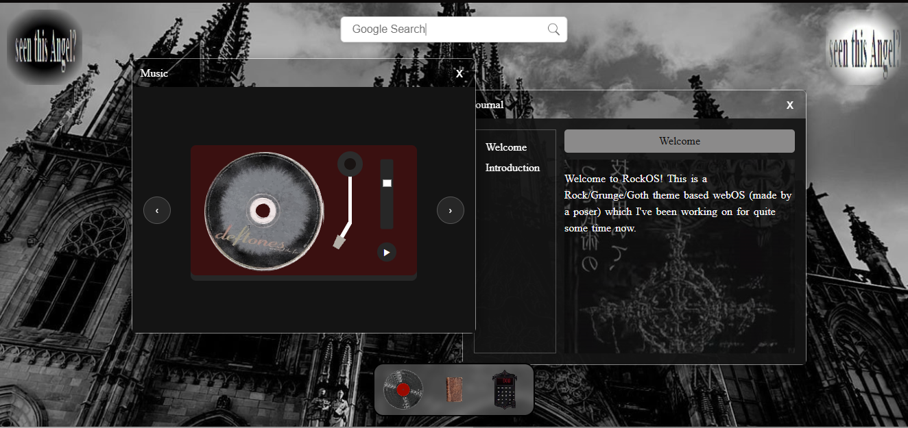

# Project: GothOS

This is a personal web-based operating system interface I built with HTML, CSS, and JavaScript on Gothic/Alt Themes.
I made this for WebOS 1 and choosed this theme as it deeply resonates with me. I'm into rock music and gothic subcultures and you can listen to some of my fav goth-rock classics in here too. It was a great start to begin with and I was so hooked up on this project tbh that I spent alotta time making and polishing this. 

## Features

1. **Clock** - Real-time clock display upto seconds in the homepage.
2. **Draggable Windows** - Gives the OS feel
3. **Notes/Journal App** -  Has preset notes which are editable. Will further work on polishing the app in future updates.
4. **Vinyl Player** - An interactive animated Vinyl Player which plays some Alt Music (MY TOP FAVS) with their CDs spinnin'.
5. **Searchbar**- A gooooogle searchbar which takes ur query, create a new window in ur browser, and searches there.
Typewriter animation to show how eager it is to get ur query XD.
6. **Visualiser**- Music Visualiser which responds to music player ONLY.
7. **"Now Playing" Flyer/Popup** - Visible on the top left of the webpage when starting/changing tracks.
8. **Calculator**- I just started working on this
9. **Taskbar** - Placeholder for all the apps with glassmorphism.

## How to Use

1. Clone or Download this respository.
2. Open the project folder
3. Open `index.html` in a web browser
4. Click on "GothOS" Header on the middle of the screen or the arrow beside it ">".
5. This will open `OS.html` which is the main webpage.

## Main Files

- `index.html` - Homepage HTML structure (Welcome Screen)
- `OS.html` - Main HTML structure 
- `script.js` - JavaScript for dragging functionality, clock updates, icon changes, paper audio plays, notes app functionality, google search bar fucntionality.
- `stylesheet.css` - Main CSS for homepage, OS, Google Search, Notes app
- `musicplayer.css` - CSS for Vinyl Player.
- `music.js` - Animations and functionality for Vinyl Player.
- `visualiser`- Animated music visualiser above the wallpaper which reacts to music from the Music Player in `OS.html`.
Please note that the visualiser only hears from the Music player in the webpage and does not hear from other tabs/browsers/system etc.
- `README.md`- THISS!

## Contributing

This is a personal project. Suggestions, bug reports, ideas and contributions are welcome!
1. Fork Respository
2. Create a branch
3. Create a feauture/specific improvement.
4. Open a pull request describing the change and/or contact mee.

## License 
MIT License: `LICENSE`

## AI Use Declaration

I created this project for the sole purpose of learning how to code. And since I'm a begginner, it wasn't easy to grasp every function. There were times when I was stuck trying to debug the visuals on `music.js` on my own and so, I used AI for debugging. I've written this README.md in my own words with no use on AI (as I did before lol).
